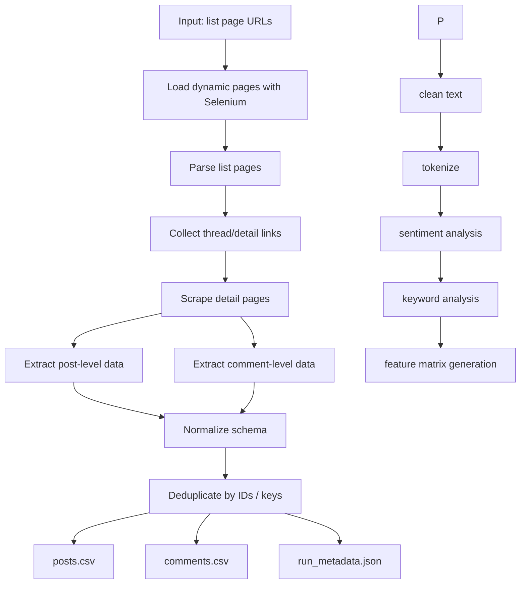

# Overview 

## What this project does

This project scrapes text data from the Chinese website Autohome for thesis research. Collecting information by hand can be very time consuming. On the other hand, scraping data online provides a much faster alternative method of data collection. To this end, this project uses a web scraping methodology to collect text data before scanning it for specific key words. These key words are then incorporated in a Principal Component Regression Analysis vis a vis company stock returns to measure which text variables were positively correlated with company performance. It uses Selenium to load target pages, extracts structured post and comment text, normalizes the data into tabular form, and writes the results to local files for downstream analysis. The repository is organized as a small Python package with a CLI, tests, and documentation.

```md
## Scraping pipeline



# Quickstart

### Prerequisites
- Python 3.10+
- Chrome/Chromium (Selenium will use it)

For full instructions on how to run the scraper, configuration options, and examples, see:
➡️ [Usage Guide](USAGE.md)

## Configuration

Copy `.env.example` to `.env` and update values as needed:

```bash
cp .env.example .env

### Install
```bash
git clone https://github.com/wmeikle33/Thesis-Webscraper.git
cd Thesis-Webscraper
python -m venv .venv
source .venv/bin/activate  # Windows: .\.venv\Scripts\Activate.ps1
pip install -e .
pip install -e .[dev]
thesis-webscraper --help

```

```bash

thesis-webscraper run \
  --section used-cars \
  --pages 10 \
  --out-dir data \
  --headless \
  --delay-ms 1200 \
  --jitter 0.4 \
  --max-retries 2 \
  --resume \
  --verbose

```

## How it works

1. **List Page Parsing**  
   The scraper opens automotive forum or listing pages and collects candidate post URLs for further processing.

2. **Detail Page Parsing**  
   Each post page is loaded using Selenium, and the scraper extracts post-level information, including titles, content, timestamps, and available comments.

3. **Data Validation, Deduplication, and Normalization**  
   Scraped records are validated, duplicates are removed using post and comment identifiers, and data is transformed into a consistent schema for downstream processing.

4. **Data Storage and Metadata Tracking**  
   Structured records are saved to CSV or other supported formats. Scraping metadata, including timestamps, source information, and execution details, is recorded to support traceability and reproducibility.

5. **NLP Preprocessing and Feature Extraction**  
   Chinese automotive forum discussions undergo text cleaning, terminology normalization, tokenization, and optional stopword removal. Keyword extraction, sentiment analysis, and text feature generation are then performed to quantify consumer discussions about electric vehicles.

6. **Feature Engineering and Principal Component Analysis (PCA)**  
   NLP-derived features are aggregated by company and time period, combined into a numerical feature matrix, and standardized. PCA is applied to reduce dimensionality, identify major patterns in consumer discussions, and generate principal components for subsequent analysis.

7. **Regression Analysis and Model Evaluation**  
   Principal Component Regression (PCR) and alternative regression models are used to examine relationships between consumer discussion features and automotive stock returns. Model performance is evaluated using regression metrics, statistical diagnostics, and time-series validation.

8. **Results Interpretation and Visualization**  
   PCA loadings, explained variance, regression coefficients, and model diagnostics are analyzed to interpret the relationships between consumer discussions and financial outcomes. Results are summarized through visualizations and statistical reports.

## What it outputs

After a successful run, the scraper writes data to:

```
./data/ (default output directory)
posts.csv — forum post-level data
comments.csv — comment-level data (if applicable)
run_metadata.json — run info (timestamp, args, counts, errors)
model_comparison.csv

```
# Schema

## posts.csv

```bash

post_id (string) — unique ID (from URL or page)
url (string)
title (string, UTF-8)
body (string, UTF-8)
author (string)
created_at (string / ISO timestamp if available)
scraped_at (string / ISO timestamp)
source (string) — e.g., autohome

```

## comments.csv

```bash

post_id (string) — foreign key to posts.csv
comment_id (string)
comment_text (string, UTF-8)
comment_author (string)
comment_created_at (string)
scraped_at (string)

```

## Repository Structure

The project is organized into the following directories:

## Repository structure

```text
.
├── .github/workflows/   # CI configuration
├── data/                # Output data and sample artifacts
├── docs/                # Additional project documentation
├── src/                 # Python package source code
├── tests/               # Automated tests and fixtures
├── notebooks/    
├── Changelog.md
├── LICENSE
├── MIGRATING.md
├── README.md
├── USAGE.md
└── pyproject.toml

```
## Quality checks

GitHub Actions CI runs on pushes to `main` and pull requests and currently covers:

- Ruff linting (`ruff check .`)
- Ruff formatting check (`ruff format --check .`)
- Unit tests with `pytest`
- Package build validation (`python -m build`)
- Package metadata validation (`python -m twine check dist/*`)

The workflow runs on Python 3.10, 3.11, and 3.12.
